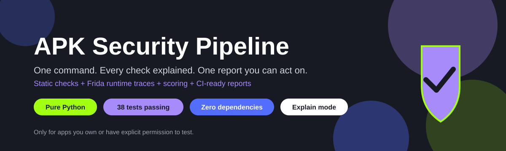
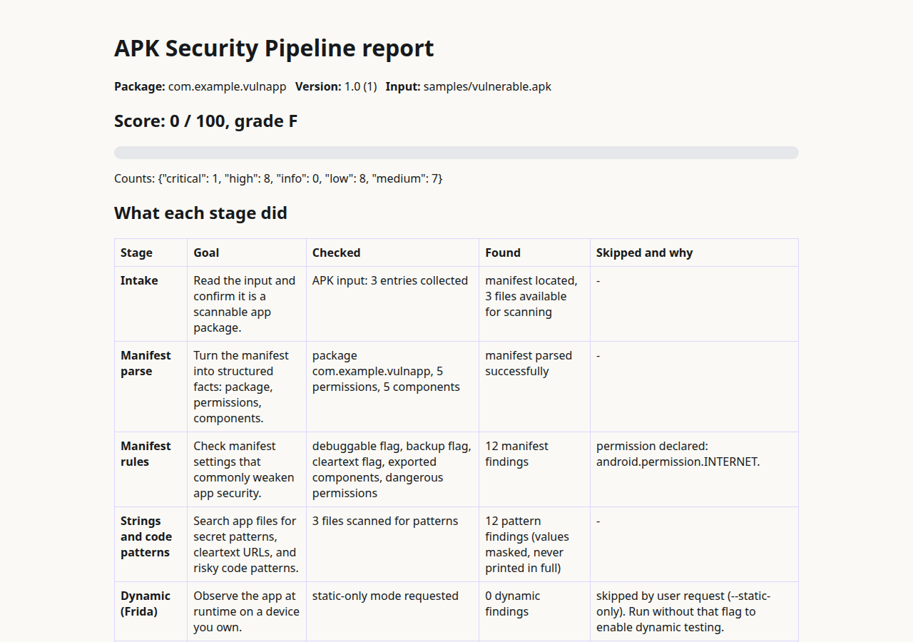
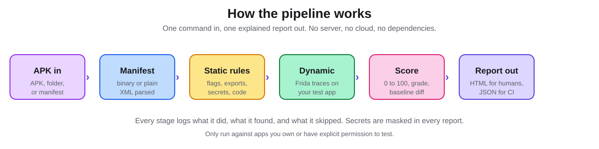
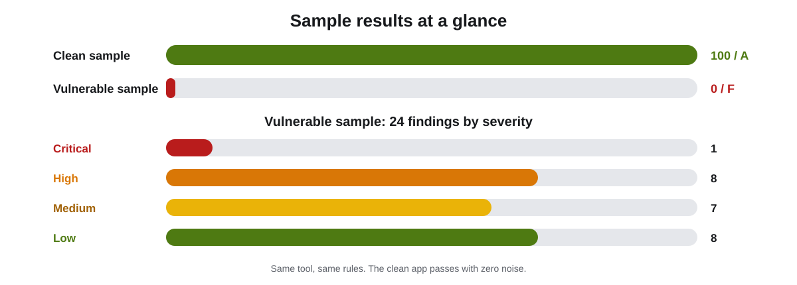

**One command that security checks an Android app and explains every step it takes.**

Give it an APK from a test app you own. It checks the manifest, the strings, the code patterns, and the runtime behaviour, then hands you one score, one grade, and one report where every finding says what it found, where it found it, why it matters, and how to fix it. No server, no cloud, no dependencies, no sign up.

> **Safety first:** only run this against apps you built yourself, or apps you have explicit permission to test, on devices and emulators you own. Never run it against store apps, other people's apps, or apps with real user data.



*A real report: the vulnerable sample scores 0/100, grade F, with a stage log that shows exactly what each stage did.*



## 🎯 Why this tool, and why it is different

Most scanners print a wall of warnings and leave you to figure out what matters. This one is built around five ideas:

1. **Explained, not just listed.** Every stage logs its goal, what it checked, what it found, and what it skipped and why. Run with `--explain` and you see the whole story in the terminal. The same log is embedded in every HTML report.
2. **Static plus dynamic, linked.** Static reading finds risky settings and patterns. Runtime traces prove what the app actually does. When both point at the same issue, the finding carries both kinds of evidence.
3. **Honest about skips.** If no device is connected, the dynamic stage says so, with the exact reason and setup steps. It never fakes evidence to look complete.
4. **Safe by default.** Secret-like values are masked in every report. Dynamic scripts log hosts and algorithm names only, never full URLs, tokens, keys, or file contents.
5. **Built for CI.** JSON output, baseline compares, and exit codes mean a build can fail on new issues only, not on old known ones.

## 🚀 Quick start

```bash
git clone https://github.com/mizazhaider-ceh/apk-security-pipeline.git
cd apk-security-pipeline

# Try it on the included samples first (synthetic test APKs, fake data only)
python3 -m apk_pipeline scan samples/clean.apk --static-only --explain
python3 -m apk_pipeline scan samples/vulnerable.apk --static-only
```

No install step. Python 3.10 or newer, standard library only.

## 👀 What a run looks like

Clean sample:

```text
Score: 100 / 100, grade A, findings: 0
Wrote html report: out/report.html
Wrote json report: out/report.json
```

Vulnerable sample:

```text
Score: 0 / 100, grade F, findings: 24
Wrote html report: out/report.html
Wrote json report: out/report.json
Failing: findings at or above threshold 'high' found.
```

| Sample | Score | Grade | Findings | What it proves |
| --- | --- | --- | --- | --- |
| `samples/clean.apk` | 100 | A | 0 | A safe manifest and clean code pass with no noise |
| `samples/vulnerable.apk` | 0 | F | 24 | Debuggable app, cleartext, exports, secrets, risky code all caught |

The vulnerable sample plants, on purpose: a debuggable app, cleartext traffic, backup allowed, five exported components without permissions, four dangerous permissions, secret patterns, a cleartext URL, and risky code patterns (WebView settings, ECB, MD5, plain Random, debug logs).



## ⌨️ Command reference

```bash
python3 -m apk_pipeline scan <input> [options]
```

| Flag | What it does |
| --- | --- |
| `-o, --output DIR` | Output directory for reports (default: `out`) |
| `--format html\|json\|both` | Which reports to write (default: `both`) |
| `--explain` | Print what every stage does, checks, finds, and skips |
| `--static-only` | Skip the dynamic stage entirely |
| `--dynamic-log FILE` | Feed a manual Frida JSON lines log back in |
| `--rules FILE` | JSON file with extra string patterns |
| `--baseline FILE` | Previous `report.json` to compare against |
| `--fail-on LEVEL` | Fail (exit 2) on findings at or above this level |

Other commands: `python3 -m apk_pipeline rules` lists every built-in rule. `python3 -m apk_pipeline version` prints the version.

Input can be an APK file, a decoded APK directory (apktool style, with `AndroidManifest.xml` at the root), or a single `AndroidManifest.xml` file. The manifest parser reads both binary and plain XML manifests with no apktool needed.

Exit codes: `0` means clean at your threshold, `2` means findings at or above your threshold, `1` means an input or scan error with a plain message, never a traceback.

## 🛡️ What it checks: the full findings catalog

### Manifest rules

| Rule ID | Severity | What it checks |
| --- | --- | --- |
| `MANIFEST_DEBUGGABLE` | Critical | App is debuggable, which lets anyone inspect runtime state and data |
| `MANIFEST_CLEARTEXT` | High | `usesCleartextTraffic` is true, so traffic can be read and changed |
| `MANIFEST_EXPORTED_NO_PERMISSION` | High | Component is exported with no permission, so any app can reach it |
| `MANIFEST_IMPLICIT_EXPORT` | Medium | Component has an intent filter but no explicit `exported` value |
| `MANIFEST_ALLOW_BACKUP` | Medium | Backup is allowed, which can copy private data to another machine |
| `PERMISSION_DANGEROUS` | Low | Dangerous permission declared, with a plain language risk note per permission (21 mapped: contacts, location, camera, microphone, SMS, and more) |

Exported components protected by a permission are not flagged. Components with `exported=false` are noted as good in the stage log.

### Secrets and network patterns

| Rule ID | Severity | What it checks |
| --- | --- | --- |
| `SECRET_AWS_KEY` | High | AWS access key id pattern in app files |
| `SECRET_PRIVATE_KEY` | High | Private key material marker in app files |
| `SECRET_GENERIC_ASSIGN` | Medium | Key, secret, or password assigned to a literal value |
| `SECRET_JWT` | Medium | JSON Web Token pattern baked into the app |
| `URL_CLEARTEXT` | Medium | Cleartext `http://` URL (namespace URIs are excluded, they are not network calls) |

Evidence is always masked: you see the pattern, the file, and the offset, never the full value. URLs are shown as scheme plus host only, with path and query removed.

### Code patterns (dex and smali files)

| Rule ID | Severity | What it checks |
| --- | --- | --- |
| `CODE_UNIVERSAL_ACCESS` | Medium | WebView universal file access, which can let web content read local files |
| `CODE_HOSTNAME_ALL` | Medium | Hostname verification disabled, so TLS host checks are skipped |
| `CODE_ECB` | Medium | ECB cipher mode, which leaks plaintext patterns |
| `CODE_JS_ENABLED` | Low | WebView JavaScript enable call, review the WebView settings |
| `CODE_MD5` | Low | MD5 digest use, broken for integrity and passwords |
| `CODE_SHA1` | Low | SHA-1 digest use, weak for integrity |
| `CODE_WEAK_RANDOM` | Low | Plain `Random` use, predictable and unfit for security |
| `CODE_INSECURE_LOG` | Low | Debug logging call, logs can leak data on user devices |

Code patterns are review flags, not proof of exploitability on their own. The report says this plainly, and each finding tells you what to check next.

### Scoring

Start at 100. Deduct 25 per Critical, 15 per High, 7 per Medium, 3 per Low, 0 per Info. Floor at 0. Grades: A (90+), B (75+), C (60+), D (40+), F (below 40). The same score on the same input is always the same: two runs produce byte identical JSON reports.

## 💬 Explain mode: the tool tells you what it is doing

```text
== APK Security Pipeline: what each stage did ==
- Intake
  Goal: Read the input and confirm it is a scannable app package.
  Checked: APK input: 3 entries collected
  Found: manifest located, 3 files available for scanning
- Manifest rules
  Goal: Check manifest settings that commonly weaken app security.
  Checked: debuggable flag, backup flag, cleartext flag, exported components, dangerous permissions
  Found: 0 manifest findings
  Skipped: debuggable flag: not set to true (good).; activity .MainActivity: exported=false (good).
- Strings and code patterns
  Goal: Search app files for secret patterns, cleartext URLs, and risky code patterns.
  Checked: 3 files scanned for patterns
  Found: 0 pattern findings (values masked, never printed in full)
- Dynamic (Frida)
  Goal: Observe the app at runtime on a device you own.
  Checked: static-only mode requested
  Found: 0 dynamic findings
  Skipped: skipped by user request (--static-only). Run without that flag to enable dynamic testing.
- Scoring
  Goal: Turn findings into one score and grade, so results are comparable over time.
  Checked: 100 minus deductions per severity (critical 25, high 15, medium 7, low 3)
  Found: score 100, grade A
```

## 📄 Reports: HTML for humans, JSON for machines

- `report.html`: single file, inline CSS, no external requests, no JavaScript. Score bar, stage log table, findings with severity, rule id, location, masked evidence, why it matters, and how to fix it, plus the limits section.
- `report.json`: the same data, sorted keys, for scripts, CI, and baseline compares. Fields include package, version, permissions, components, findings, score, grade, counts, stage log, baseline, and limits.

## 🔬 Dynamic testing with Frida

The automatic run never fakes dynamic evidence. If Frida or a device is missing, the report says so with the exact reason and setup steps, and the rest of the pipeline still runs.

| Script | What it logs | What it never logs |
| --- | --- | --- |
| `frida/trace-network.js` | HTTP client calls, scheme plus host only | Full URLs, headers, bodies, tokens |
| `frida/trace-storage.js` | Preference keys and file names touched | Values, file contents |
| `frida/trace-crypto.js` | Cipher and MessageDigest algorithm names only | Keys, plaintext, ciphertext |
| `frida/trace-intents.js` | Started screens and intent actions only | Intent extras, user data |

How to run it, step by step (full guide in `frida/README.md`):

1. Start an emulator you own. Confirm it with `adb devices`.
2. Install your own test app on that emulator.
3. Start the Frida server on the emulator.
4. Run a script, for example: `frida -U -f com.example.mytestapp -l trace-network.js`
5. Use the app through a scripted flow: open screens, save data, trigger a network call.
6. Save the JSON lines to a file, for example `frida-log.jsonl`.
7. Feed it back: `python3 -m apk_pipeline scan my-test-app.apk --dynamic-log frida-log.jsonl`

Spawn versus attach, in short: spawn (`-f`) starts the app under Frida from the beginning and catches early calls. Attach (`-p <pid>`) connects to a running app where classes are already loaded. If a trace shows little at spawn, try attach after the main screen loads. Both behaviours are normal and worth noting in your report.

## 🔁 Baseline and CI: fail only on new issues

```bash
# First run: save the baseline
python3 -m apk_pipeline scan my-test-app.apk -o baseline-out --fail-on never

# Later runs: compare, and fail only when new findings appear
python3 -m apk_pipeline scan my-test-app.apk --baseline baseline-out/report.json --fail-on high
```

The baseline section of the report lists new, fixed, and unchanged findings, so a team can see progress, not just problems.

GitHub Actions example:

```yaml
- name: APK security scan
  run: |
    python3 -m apk_pipeline scan app/build/outputs/apk/debug/app-debug.apk \
      --fail-on high
```

## 🧩 Custom rules

Add your own string patterns without touching the code:

```json
{"patterns": [{"id": "MY_MARKER", "pattern": "my-secret-marker",
"explanation": "My custom pattern.", "fix": "Remove it."}]}
```

```bash
python3 -m apk_pipeline scan app.apk --rules my-rules.json
```

Bad regex in a custom rule does not crash the scan: the rule is skipped and the rest of the pipeline runs. That behaviour is covered by tests.

## 🏗️ How it is built

```text
apk_pipeline/
  axml.py        binary XML parser (standard library only)
  axml_write.py  binary XML writer, used for test fixtures
  manifest.py    manifest extraction, binary or plain XML
  rules.py       rules, scoring, masking
  scanner.py     stage orchestration, baseline compares
  dynamic.py     Frida harness, device checks, log parsing
  report.py      HTML and JSON writers
  cli.py         command line interface
frida/           runtime trace scripts plus guide
samples/         sample APK generator plus clean and vulnerable test APKs
tests/           unit tests and deep tests
assets/          pipeline diagram and report preview
```

Design choices worth knowing:

- **No dependencies on purpose.** A security tool that needs a long install is a tool that does not get run. Standard library only means it runs anywhere Python 3.10 runs.
- **Parser first, patterns second.** The manifest becomes structured facts before any rule runs, so rules stay simple and testable.
- **Masking at the source.** The scanner masks values before reports are written, so no report writer can accidentally leak a secret.
- **Skips are first class results.** A skipped stage is reported with its reason, not hidden. That is what makes the tool trustworthy in a review.

## ✅ Testing

```bash
python3 -m unittest discover -s tests -v
```

38 tests, all passing. Coverage includes binary and plain manifest parsing, manifest variants, input handling, scoring math, secret masking, custom rules, baseline compares, report escaping (a crafted component name with script markup is escaped, not executed), determinism, CLI exit codes and formats, and dynamic log edge cases. The full deep test report, including defects found and fixed, is in [TEST_REPORT.md](TEST_REPORT.md).

## ⚖️ How it compares

| | APK Security Pipeline | Big all-in-one scanners |
| --- | --- | --- |
| Install | None, standard library only | Heavy, server based, many dependencies |
| Run | One CLI command, seconds | Often a server plus a web UI |
| Output | One score, one explained report, JSON for CI | Long reports that need triage |
| Dynamic | Frida scripts you can read and change | Built in, harder to adjust |
| Best for | Your own test apps, learning, CI gates, demos | Full enterprise app review |

This tool does not claim to beat the big scanners. It claims to be small, fast, clear, and fully explainable, which is a different and useful thing.

## ⚠️ Limits, read these

- Static patterns are review flags, not proof of exploitability on their own.
- Dynamic results only cover the flows you actually ran.
- Binary manifest parsing covers the common manifest shapes. Very unusual manifests may need a decoded directory input instead.
- This tool never proves an app is safe. It reports what it found and what it checked.
- A real production APK scan and a live Frida run on a real emulator are still the final proof steps, and they are tracked openly in TEST_REPORT.md.

## 🗺️ Roadmap

- More manifest rules: network security config review, deep link review.
- Smali level checks with method context, not just byte patterns.
- Automatic dynamic runs once a target package and flow file are given.
- SARIF output for GitHub code scanning.
- A second sample app with a real build (Kotlin) once an Android SDK is available.

## ❓ FAQ

**Is this a hacking tool?**
No. It is a testing pipeline for apps you own or have explicit permission to test. The safety rule is on the README cover and in every report footer for a reason.

**Does it upload my APK anywhere?**
No. Everything runs locally. The HTML report has no external requests and no JavaScript.

**Why is the clean sample 100/100? Does that mean the app is safe?**
No. It means none of the rules matched. The report says this in plain words on every clean run. No scanner proves safety.

**Why did the dynamic stage skip?**
Because Frida, adb, or a connected device is missing, or you passed `--static-only`. The report names the exact reason and what to install or start. That skip is a feature, not a bug.

**Can I use it in CI?**
Yes. Use `--fail-on` for exit codes, `--format json` for machine output, and `--baseline` to fail only on new findings.

**Can I add my own rules?**
Yes, with `--rules` and a JSON pattern file. Manifest rules and code patterns live in `rules.py` if you want to extend the code itself.

**What Python version do I need?**
Python 3.10 or newer. No packages to install.

## 🤝 Contributing

Issues and pull requests are welcome. Please keep these rules: no new dependencies without a strong reason, every new rule gets a test, every finding keeps its explanation and fix text, and never add a real secret, real app, or real user data to samples or tests. Run the full suite before opening a pull request.

## 📜 License

MIT. Created by Muhammad Izaz Haider.
